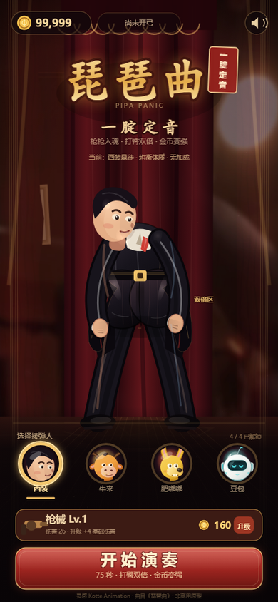
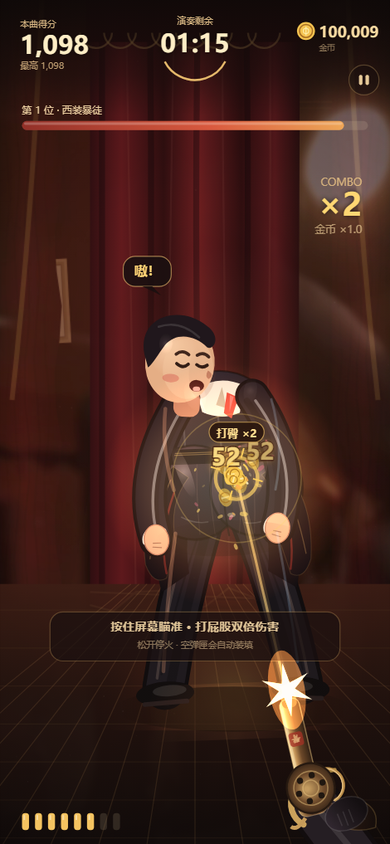
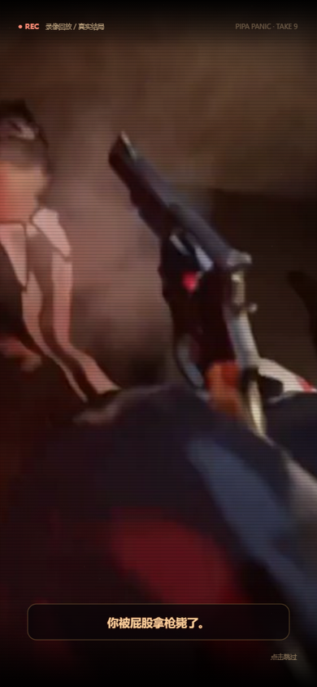
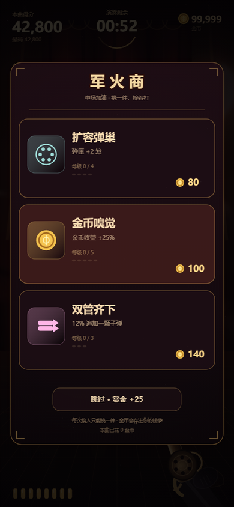
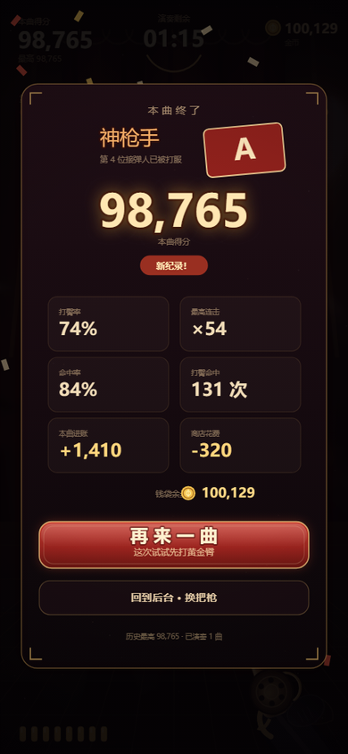
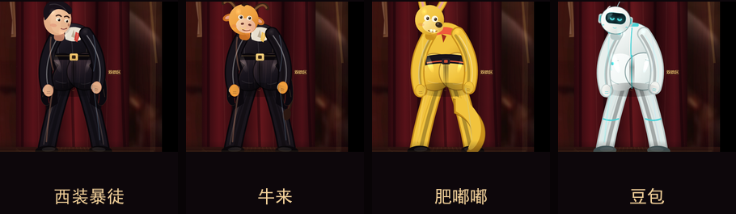

# 琵琶曲：一腚定音 <small>PIPA PANIC</small>

一个以「琵琶曲 + 打屁股接子弹」网络梗为灵感的 **卡通打靶 × 肉鸽升级** 微信小游戏原型。

玩家扮演拿左轮手枪的射击者，对着不断换人的「接弹人」开枪。**打中屁股造成双倍伤害、双倍金币**；金币可以在局内买肉鸽强化，也可以在局外升级枪械、解锁 **牛来 / 肥嘟嘟 / 豆包** 三套皮肤。

> 这是一个可运行、可打包的原型，不是只停留在概念稿。角色、UI、枪械和特效由 Canvas 2D 逐帧绘制；场景使用参考视频的 3D 房间景深帧；失败过场使用视频中的「被屁股拿枪反杀」帧序列，并保留原声。角色是 **2.5D 伪 3D 渲染**：球面光照、高光、环境遮蔽、接触阴影、边缘光和受击形变。







## 快速开始

### 浏览器试玩

直接双击 `index.html` 即可。

如果浏览器限制本地音频，建议起一个静态服务器：

```powershell
cd D:\AI\workspaces\pipa-panic
python -m http.server 8765
```

如果系统没有可用的 `python`，直接使用 DSH 自带的 Python：

```powershell
& 'C:\Users\DELL\.dsh\dsh-runtimes\dsh-primary-runtime\dependencies\python\python.exe' `
  -m http.server 8765 --directory 'D:\AI\workspaces\pipa-panic'
```

打开 <http://127.0.0.1:8765/>。

**全解锁体验模式**：打开 <http://127.0.0.1:8765/?demo=1>，金币 99999、四套皮肤全解锁、所有强化可试。

### 微信开发者工具

1. 打开「微信开发者工具」→ 导入项目。
2. 项目目录选择 `D:\AI\workspaces\pipa-panic`。
3. 项目类型选择「小游戏」。
4. `project.config.json` 里的 AppID 是 `touristappid`，可直接用于本地预览；上传前换成你自己的小游戏 AppID。
5. 编译后即可在模拟器里玩；真机预览时注意开启音频。

> 微信小游戏入口为根目录 `game.js`，`game.json` 已配置竖屏、隐藏状态栏。`project.config.json` 已把 `docs`、`refs`、`tools`、`README.md` 和 `index.html` 排除出上传包，主包约 **1.3 MB**。

## 玩法

| 操作 | 说明 |
|---|---|
| 按住屏幕 / 鼠标 | 瞄准并连续开火 |
| 移动手指 / 鼠标 | 移动准星 |
| 松开 | 停火 |
| `R` | 手动装填 |
| `Space` | 开火（桌面端） |
| `P` / `Esc` | 暂停 |
| `M` | 静音 |
| `Enter` | 开始 / 继续 / 重开 |

### 命中分区

| 部位 | 伤害 | 金币 | 说明 |
|---|---|---|---|
| 屁股 | **2.0× 起** | 5 起 | 核心玩法；升级「双倍快乐」可到 2.5× / 3× |
| 身体 | 1.0× | 2 | 稳定输出 |
| 头部 | 0.62× | 1 | 会触发「别打脸」吐槽，故意不鼓励 |
| 落空 | 0 | 0 | 连击清零，墙上留下弹孔 |

- **黄金臀**：每隔约 9–13 秒出现 2.7 秒，屁股发出金光，期间打臀额外 +1.1× 倍率，金币翻倍。
- **连击**：命中累积 Combo，1.55 秒内不命中会断；Combo 最高提供 1.8× 金币系数。
- **打臀反馈**：金币喷出、屏幕震动、数字弹出、角色挤眼张嘴、手机轻震。
- **受击动作**：角色会随命中方向侧倾、手臂甩动、头部偏转、臀部晃动，叠加枪口闪光、弹道和金币粒子。
- **KO**：打空血条后角色会向前扑倒，随后获得 KO 金币、时间 +2.5 秒，进入军火商商店。
- **失败反杀**：倒计时归零不会直接跳结算，而是播放视频里的「接弹人从身后掏出左轮、朝镜头开枪、玩家倒下」过场，字幕「你被屁股拿枪毙了」，再进入结算。
- **3D 舞台**：视频房间的景深帧 + 中央红丝绒幕布 + 透视木地板 + 聚光灯 + 体积尘，角色带高光、环境遮蔽和接触阴影，并随瞄准产生轻微镜头视差。

## 系统

### 局内肉鸽（军火商）

每次 KO 后三选一，用本局金币购买，立刻生效：

| 强化 | 效果 | 最大等级 |
|---|---|---|
| 枪管抛光 | 伤害 +22% | 6 |
| 快手扳机 | 射速 +12% | 6 |
| 臀部雷达 | 打臀判定 +14% | 4 |
| 双倍快乐 | 打臀倍率 +0.5× | 3 |
| 金币嗅觉 | 金币收益 +25% | 5 |
| 暴击火药 | 暴击率 +7% | 5 |
| 扩容弹巢 | 弹匣 +2 发 | 4 |
| 余音绕梁 | 15% 不消耗子弹 | 3 |
| 双管齐下 | 12% 追加一颗子弹 | 3 |

买不起可以「跳过 · 赏金 +25」。所有强化只在本局生效。

### 局外成长

- **枪械升级**：Lv.1–Lv.12，每级 +4 基础伤害，费用递增。
- **皮肤解锁**：永久解锁，附带小型被动。
- **存档**：`wx.setStorageSync` / `localStorage`，保存金币、最高分、枪等级、皮肤、历史连击等。

| 皮肤 | 价格 | 被动 | 设计 |
|---|---:|---|---|
| 西装暴徒 | 免费 | 无 | 黑西装、红领带、油头，经典接弹人 |
| 牛来 | 600 | 得分 +12% | 橘色牛头、深棕角、肉色口鼻，致敬「拒绝讨好的牛」 |
| 肥嘟嘟 | 1400 | 金币 +12% | 黄色袋鼠、长耳、大鼻子、黑短裤 |
| 豆包 | 2400 | 暴击 +6% | 豆形白色机器人、青色面罩、天线 |



### 一局的结构

```
75 秒倒计时
  └─ 第 1 位接弹人（1500 HP）
       └─ 打空血条 → KO（+2.5s）→ 军火商三选一
            └─ 第 2 位（2370 HP）→ 第 3 位（3480 HP）→ ...
                 └─ 时间归零 → 结算（S/A/B/C 评级）
```

目标血量：`1500 + (波次-1) × 750 + (波次-1)² × 120`。

时间归零后结算；KO 和商店期间计时暂停。强制结算会保留本局所有已获得金币。

## 文件结构

```
pipa-panic/
├─ game.js                 # 单文件游戏：循环、绘制、输入、音频、状态机
├─ game.json               # 微信小游戏配置（竖屏 / 隐藏状态栏）
├─ project.config.json     # 微信开发者工具项目配置
├─ index.html              # 浏览器预览壳
├─ assets/
│  ├─ audio/pipa-theme.mp3    # 从参考视频提取的背景音乐（原型用）
│  ├─ cutscene/lose-sheet.jpg # 失败反杀过场：15 帧视频序列
│  ├─ cutscene/lose-sting.mp3 # 失败过场原声
│  ├─ images/bg-video-main.jpg# 视频房间景深背景
│  ├─ images/icon.png         # 512×512 游戏图标（可上传用）
│  └─ images/share.png        # 5:4 分享封面
├─ docs/
│  ├─ GDD.md               # 详细策划与数值说明
│  ├─ QA.md                # 测试记录与复测命令
│  ├─ screenshots/         # 最终截图
│  └─ references/          # 参考视频抽帧拼图
└─ tools/                  # 本地 QA / 截图脚本（不打包）
```

## 适配与性能

- 设计分辨率 **390 × 844**，按 `contain` 缩放并居中；手机、平板、桌面浏览器都不会拉伸。
- 按 `devicePixelRatio` 渲染（最高 3×），Canvas 内部分辨率跟随屏幕。
- 程序化房间背景缓存到 offscreen canvas；视频景深层、幕布、地板、角色、粒子逐帧叠加。
- 微信端优先使用 `wx.createWebAudioContext()` 合成音效；不支持时静默降级，不阻塞游戏。
- 浏览器端使用 Web Audio 合成音效 + `<audio>` 循环 BGM。
- 无网络请求、无第三方统计 SDK；背景、过场帧和音频均为本地参考素材。

## 已验证

在 Edge 无头浏览器 + Chrome DevTools Protocol 下模拟 390×844 手机视口完成了以下测试：

- 75 秒长局模拟：261 发、261 命中、5 波、4 次商店，最终 SSS 评级，无 JS 异常。
- 命中判定：连续打臀 261 次，Combo 261，金币与分数正常增长。
- KO → 商店：3 张随机卡、购买扣款、强化生效、下一波血量正确。
- 装填：空弹匣后自动装填，装填完成后继续开火。
- 皮肤购买弹窗：真实鼠标点击解锁牛来，金币 1000 → 400，皮肤写入存档。
- 重开：上一局强化不会污染新一局（`up = {}`、伤害 26、弹匣 8）。
- 四套皮肤、菜单、战斗、商店、结算、购买弹窗均截图验证。
- **失败反杀**：倒计时归零 → `losing` 状态 → 15 帧视频过场 + 原声 → 结算，状态机通过 WeChat mock 验证。
- 微信 API 模拟测试：用 `wx` / Canvas stub 跑通启动、开始、射击、结算、失败过场、存档、切后台，确认没有误用 `window` / `document`。
- 刘海安全区：微信端会根据 `safeArea` 将整个 390×844 舞台缩进安全区域，HUD 不压到刘海和 Home 指示条。

> 说明：以上是浏览器自动化 + 微信 API 模拟测试。微信小游戏真机上的音频、震动、刘海屏安全区和触摸手感，仍建议在微信开发者工具和至少一台 iOS / Android 真机上复测。详细记录见 [docs/QA.md](docs/QA.md)。

## 上线前必须处理

### 1. 版权与授权

这是**非商用同人原型**。正式上线前请确认：

- **音乐**：当前 BGM 从用户提供的 `素材2.mp4` 提取。公开报道提到该梗常用曲目为方浩《琵琶曲》的 DJ 版本；无论实际权利人是谁，商用发行都需要获得音乐授权，或替换为可商用/原创琵琶曲。
- **视频画面**：当前背景景深帧、失败反杀过场帧和过场原声都直接来自用户提供的参考视频。它们仅用于本地原型演示；正式发行必须取得 Kotte Animation / 原视频权利人的授权，或用原创 3D 渲染重制。不要把这些帧直接上传到公开版本。
- **皮肤 IP**：「牛来」「肥嘟嘟」「豆包」涉及第三方角色/品牌形象。当前是原创风格的卡通演绎，不等于获得授权；商用前应取得授权，或替换为原创吉祥物。
- **字体**：代码使用系统字体回退（KaiTi / Songti / 苹方 / 微软雅黑），没有打包字体文件。

### 2. 内容审核

「射击真人 + 打屁股」的题材在微信小游戏审核中有被判定为低俗、性暗示或暴力的风险。当前版本已经做了这些降级：

- 无血液、无伤口、无死亡表现；
- 卡通化、夸张化，角色始终穿衣服；
- 命中有吐槽和金币，不表现痛苦虐待；
- 明确写「非商用原型」。

如果目标是正式过审，建议进一步改成 **「铁臀训练营」/「接弹人训练靶」**：把人类靶子换成机器人或沙袋，把「打屁股」改成「打靶心」，用橡胶弹/训练弹替代左轮，去掉扭动和性暗示姿势。这样保留核心的「打臀双倍」笑点，但审核风险会低很多。

### 3. 资质与平台要求

按发行地区和平台要求办理：

- 小游戏 AppID、类目、软件著作权、版号/备案；
- 实名认证、防沉迷、未成年人保护；
- 隐私政策（本原型不采集数据；如果接广告、云存档、排行榜，需要同步更新）；
- 分享素材、游戏图标、截图和简介的合规审核；
- iOS 端虚拟支付限制（如涉及内购）。

### 4. 建议的下一步

- [ ] 用微信开发者工具真机预览，校准 `safeArea` 顶部/底部和安全区；
- [ ] 替换为已授权音乐，增加节拍点与 Boss 阶段；
- [ ] 增加每日挑战、排行榜、成就；
- [ ] 增加更多枪械（霰弹枪、连发步枪）和弹道差异；
- [ ] 增加角色语音/拟声词（可用原创音效）；
- [ ] 接入云存档和分享卡片；
- [ ] 做 10 人可用性测试，校准 75 秒时长、掉率和皮肤价格。

## 设计文档

更完整的系统拆解、经济曲线、状态机、美术规范和审核改造方案见 [docs/GDD.md](docs/GDD.md)。

## 参考

- [「2500 个大腚被手枪爆轰」— 游民星空 / TapTap](https://www.taptap.cn/moment/851385220396483570?group_id=2999#1)
- [奶蛙、牛来、肥嘟嘟：「黄色三幻神」— 豆瓣](https://www.douban.com/topic/498683479/)
- [《牛来》：AI 时代，连牛都不做视觉讨好 — 搜狐](https://www.sohu.com/a/1078104908_611151)
- [豆包回应「豆脚」机器人 — TechWeb](https://m.techweb.com.cn/twclient/article/2026-04-20/2974488.shtml)

---

**一句话总结**：按住屏幕，瞄准那个撅起来的屁股，把琵琶弹成一把左轮。打臀双倍，金币变强，牛来、肥嘟嘟和豆包排队挨打。
